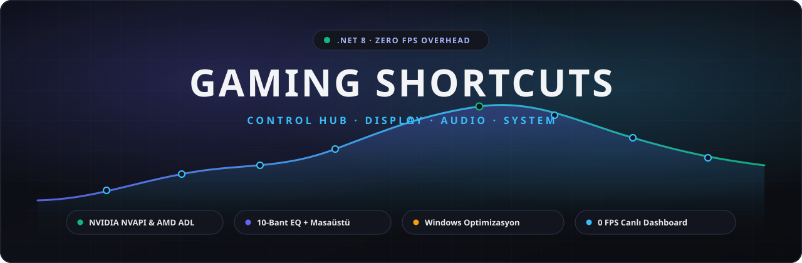
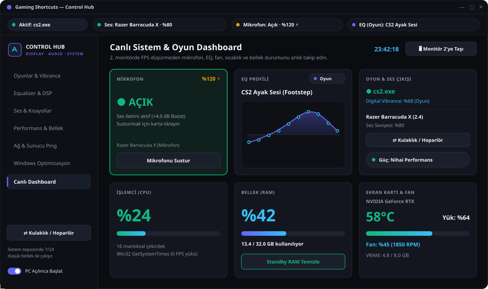

# 🎮 Gaming Shortcuts — Control Hub

**Minimalist Obsidian koyu temalı, tek dosya kurulumsuz Windows PC Oyun, Ses & Performans Kontrol Merkezi**

> *Bu depo yalnızca **Gaming Shortcuts** uygulamasının resmi çalıştırılabilir sürüm (`.exe`) dağıtımı ve kullanım dokümantasyonu içindir.*

---

## 🔗 Hızlı Erişim & Direkt İndirme Linkleri

| Bağlantı | Açıklama | Link |
| :--- | :--- | :--- |
| **⬇️ Direkt `.exe` İndir (Tek Tık)** | Kurulum ve .NET gerektirmez — indirip doğrudan çalıştırın | [**GamingShortcuts.exe İndir (v1.0.0)**](https://github.com/CanOruckahya/gaming-shortcuts-release/releases/latest/download/GamingShortcuts.exe) |
| **📦 Sürüm Sayfası (Releases)** | Sadece çalıştırılabilir `.exe` ve sürüm notları | [**Releases / Son Sürüm**](https://github.com/CanOruckahya/gaming-shortcuts-release/releases/latest) |
| **📖 Sadece README Görünümü** | Temiz tanıtım ve kullanım kılavuzu sayfası | [**README.md (Standalone)**](https://github.com/CanOruckahya/gaming-shortcuts-release/blob/main/README.md) |
| **👤 Geliştirici Profili** | Diğer projeler ve GitHub profili | [**@CanOruckahya**](https://github.com/CanOruckahya) |

---

## 🖥️ Arayüz & Canlı Dashboard Önizleme

> **Obsidian & Slate** koyu tema estetiğiyle tasarlanan arayüz; sistem tepsisinde (saatin yanında) 7/24 düşük bellek tüketimiyle çalışır ve tek tıkla 2. monitöre taşınabilir.

---

## ✨ Öne Çıkan Özellikler

### 1. 🎯 Çoklu Oyun (`.exe`) Profili, Çift GPU Renk Motoru & Sürücü Kontrolü
* **Otomatik GPU Algılama (NVIDIA + AMD):** Sistemdeki NVIDIA, AMD ve dahili Intel ekran kartlarını otomatik tanır.
  * **NVIDIA:** `nvapi64.dll` üzerinden gerçek **Digital Vibrance (%0 – %100)**.
  * **AMD:** `atiadlxx.dll` üzerinden gerçek **Renk Doygunluğu / Saturation (%0 – %100)**.
  * **Hibrit Laptop Desteği:** Optimus/hibrit sistemlerde aktif ekranı süren GPU'yu otomatik seçer, gerekirse diğer motora düşer.
* **Alt+Tab & Tam Ekran Odak Koruması:** Oyundan Alt+Tab ile masaüstüne geçtiğinizde otomatik masaüstü renk değerine döner; oyuna dönünce oyun profilini geri yükler.
* **GPU Sürücü Sağlığı & Güncellik Kontrolü:** Kurulu sürücü sürümünü, tarihini, API DLL durumunu ve NVIDIA kartlarda çevrimiçi WHQL güncelliğini tek tıkla kontrol eder; resmi sürücü indirme sayfasını açar.

### 2. 🎚️ 10-Bant Grafik Equalizer (EQ) & Oyun Dışı (Masaüstü) EQ
* **0 ms Gecikmeli DSP:** [Equalizer APO](https://sourceforge.net/projects/equalizerapo/) (`Stage: post-mix`) ile gerçek zamanlı 10-bant (`31Hz – 16kHz`) frekans tepki eğrisi.
* **Hazır Oyuncu Profilleri:** *CS2 Ayak Sesi (Footstep Boost)*, *FPS Rekabetçi*, *Dengeli Oyun*, *Bass Boost (Müzik & Sinema)*, *Vokal & Discord* ve *Özel (Kullanıcı Ayarı)*.
* **Oyun ↔ Masaüstü Otomatik EQ Geçişi:** *Oyun Açılınca Aktif* modundayken masaüstünde seçtiğiniz **Oyun Dışı EQ** (ör. *Bass Boost*) çalar; oyun açıldığında otomatik olarak oyunun EQ profiline (ör. *CS2 Ayak Sesi*) geçer.

### 3. 🎙️ Ses Aygıtları, Global Kısayollar & Patlama Önleyici Mikrofon Boost (`%0 – %150`)
* **Kulaklık ⇄ Hoparlör Tek Tuş Geçişi:** Atadığınız global kısayolla iki çıkış aygıtı arasında anında geçiş yapar ve Discord tarzı yumuşak sesli bildirim verir.
* **Mikrofon Susturma (Mute/Unmute) & Ses Kilidi:** Global mikrofon susturma kısayolu ve CS2/Discord'un mikrofon sesini kendi kendine düşürüp yükseltmesini engelleyen kilit.
* **Patlama Önleyici `%101 – %150` Mikrofon Boost:** `%100` üstüne çıkıldığında Windows seviyesini `%100`'de sabitler; Equalizer APO (`Stage: capture`) üzerinden **85 Hz High-Pass filtre** (nefes/'p-b' patlama engelleme), **7.5 kHz yumuşatma** ve temiz `+dB` kazanç (`%120 = +4.0 dB`, `%150 = +10.0 dB`) uygular.
* **Sadece `cs2.exe` Ses Kontrolü:** Discord veya sistem sesine dokunmadan yalnızca CS2 sesini `%5` artırıp azaltan kısayollar.

### 4. ⚡ Windows Oyun Optimizasyon Merkezi (`+ Tek Tıkla Geri Alma`)
Tek ekrandan yönetilen **11 güvenli ve geri alınabilir** Windows 10/11 ayarı. İlk değişiklikten önce mevcut sistem değerleriniz otomatik yedeklenir; **`↺ Tümünü Geri Al`** tuşuyla her şeyi orijinal haline döndürebilirsiniz:

| Anında Etkili Ayarlar (8 Adet) | Gelişmiş Sistem Ayarları (Yeniden Başlatma Gerektirir) |
| :--- | :--- |
| Windows Şeffaflık Efektlerini Kapat (anında DWM yenileme) | Donanım Hızlandırmalı GPU Zamanlaması (**HAGS**) Aç |
| **Nihai Performans** (*Ultimate Performance*) Güç Planı | **Power Throttling** (Güç Kısıtlaması) Kapat |
| Windows **Oyun Modu** (*Game Mode*) Aç | **MMCSS** Oyun Önceliği & Ağ Kısıtlamasını Kaldır |
| Xbox Game Bar & Arka Plan Kaydı (**Game DVR**) Kapat | |
| Fare İvmesini (*İşaretçi Hassasiyeti*) Kapat | |
| Pencere & Arayüz Animasyonlarını Kapat (ClearType korunur) | |
| Arka Plan UWP Uygulamalarını Kapat | |
| Windows Update P2P (*Delivery Optimization*) Kapat | |

### 5. 📊 Canlı Sistem & Oyun Dashboard (2. Monitör Dostu · 0 FPS Yükü)
* **Sıfır FPS Kaybı:** Harici process veya ağır sayaçlar başlatmaz. Saf Win32 CPU, RAM ve doğrudan `nvml.dll` GPU Sıcaklık, Yük, Fan (% / RPM), VRAM okur.
* **Tıklanabilir Mikrofon Hero Kartı:** Mikrofonun açık/kapalı (Mute) durumunu uzaktan net biçimde gösterir; tıklayarak anında susturup açabilirsiniz.
* **Canlı EQ Eğrisi, Aktif Oyun, Ses Çıkışı (`⇄`) & Güç Planı:** Hepsi tek ekranda; sağ üstteki **`🖥 Monitör Değiştir`** butonuyla pencereyi tek tıkla 2. monitöre alabilirsiniz.

### 6. 🧹 Bellek / Önbellek Bakımı & 🌐 6'lı Ping Telemetrisi + Cloudflare DNS
* **Standby RAM Temizleyici (`RAMMap` tarzı):** Oyun açılışında veya tek tıkla Windows Standby RAM önbelleğini temizler.
* **GPU Shader Cache & Temp Temizliği:** NVIDIA / AMD / DirectX shader önbelleklerini ve 24 saatten eski Windows Temp dosyalarını güvenle temizler.
* **6 Sunuculu Canlı Ping & Tek Tıkla `1.1.1.1` DNS:** Faceit TR (İstanbul), CS2/Faceit Frankfurt, Viyana, Amsterdam, Discord Ses (RTC) ve Cloudflare (`1.1.1.1`) gecikmelerini ölçer.

---

## 🚀 Kurulum ve Hızlı Başlangıç

1. [**GamingShortcuts.exe**](https://github.com/CanOruckahya/gaming-shortcuts-release/releases/latest/download/GamingShortcuts.exe) dosyasını indirin (tek dosya, kurulum veya .NET SDK gerektirmez).
2. Çalıştırın (sistem ayarları, güç planı ve Standby RAM temizliği için Yönetici izni ister).
3. *(İsteğe bağlı — EQ ve `%100+` Mikrofon Boost için)* Uygulama içindeki **`Equalizer & DSP`** sekmesinden **Equalizer APO** kurulumunu yapıp **`Configurator`** üzerinden kulaklığınızı (*Playback*) ve mikrofonunuzu (*Capture*) işaretleyin.

---

## 🛡️ Güvenlik & Anti-Cheat Uyumluluğu
* Harici kernel sürücüsü (`WinDivert` vb.) içermez, oyun süreçlerinin belleğine dokunmaz.
* **VAC, Faceit AC ve Riot Vanguard** ile %100 uyumludur.
